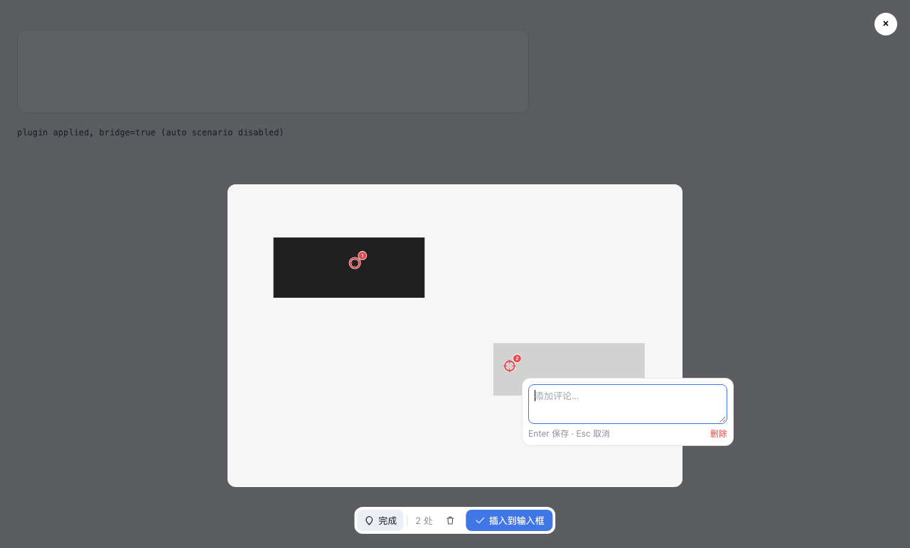

# dsh-image-pin-comment · 图片图钉标注

给 DeepSeek Harness（dsh）的图片预览加一层**图钉 + 评论**：在图上点一下钉一颗编号图钉，
图钉下方弹出评论框写一句话；点「插入到输入框」后，**原图 + 一段带坐标的说明**一起进草稿，
回车即发。

**发出去的是原图**，图钉只存在于屏幕上 —— 模型看到干净的图，靠文字里的坐标精确定位。



## 它解决什么

> 「把这个按钮往左挪 8px。」—— 模型问：哪个按钮？
> 「这里文字重叠了。」—— 模型开始认真猜「这里」是哪里。

图片进入模型后只剩像素。本插件把「这里」变成模型能直接算的东西：**图像编号 + 百分比 + 原图像素 + 容差 + 建议裁切框**。

一次可以标记多张图，每张图独立编号：

```text
这两个地方怎么改？

【图片标注】图像 1（1200×800）锚点 2 处，已在输入框中。锚点不画在图上，按下面的坐标定位：百分比 = 锚点占图片宽高的比例，px = 原图像素坐标，裁切 = 以锚点为中心的方形区域（x0,y0,x1,y1）。
1. (x: 30.0%, y: 40.0% | px 360,320 | ±13px | 裁切 321,281,399,359) 这个按钮往左挪 8px
2. (x: 70.0%, y: 65.0% | px 840,520 | ±13px | 裁切 801,481,879,559) 这里文字重叠了

【图片标注】图像 2（900×600）锚点 1 处，已在输入框中。…
1. (x: 50.0%, y: 50.0% | px 450,300 | ±10px | 裁切 420,270,480,330) 这张图的标题要加粗
```

## 流程（两次回车）

| 步骤 | 你做什么 | 插件做什么 |
| --- | --- | --- |
| 1 | 点开会话里的任意图片（消息里的截图、输入框草稿图、工具返回的图） | 预览底部出现工具条：`标注 · 0 处 · 清空 · 插入到输入框` |
| 2 | 点「标注」 | 进入图钉模式，光标变十字 |
| 3 | 在图上任意位置左键点一下 | 落一颗空心环 + 十字准星的编号图钉，下方弹出评论框并自动聚焦 |
| 4 | 打字，按 **第一次回车** | 只确认**这一颗**图钉的内容；气泡收起，仍在标注模式，可以接着钉第 2、3… 颗 |
| 5 | 全部写完，点「插入到输入框」 | 把**原图**（原字节、原分辨率）+ 坐标说明放进草稿；预览自动关闭 |
| 6 | 在输入框里补一句问题，按 **第二次回车** | 正常发送 |

要点：**第一次回车只确认图钉，第二次回车才是发出去** —— 因为图钉可以不止一个。

再多张图也一样：接着点开第二张、钉点、插入 → 自动写成「图像 2」，锚点编号**重新从 1 开始**。
「图像 N」按这一批里被标注的顺序编号，块里同时给出尺寸和附件名，便于和输入框里的附件对上号。

其它交互：

- 点已有图钉 = 重新编辑它的评论；拖动图钉 = 挪位置（坐标跟着变）；
- 气泡里 `Esc` = 取消（备注为空时这颗钉一起删掉）、`Shift+Enter` = 换行、「删除」= 删掉这颗钉；
- 同一张图再次打开：**之前的锚点会被预载回来**，编号延续，坐标块就地更新（不会出现第二份「图像 N」）；
- 图本来就在输入框里（草稿附件）：只补坐标说明，**不会重复插一张一样的图**；
- 预览右上角 `×` / `Esc` 关掉预览，整层随预览一起消失。

## 安装

### A. 本地开发（推荐先这样试）

```sh
cd /path/to/dsh-image-pin-comment
./scripts/install-local.sh            # 默认装进 desktop profile（DSH 桌面端）
./scripts/install-local.sh web        # 或 web profile
```

它做两件事：把插件目录 symlink 进 `~/.dsh/profiles/<profile>/node_modules/`，
并在该 profile 的 `cordis.patch.yml` 里追加一行挂载配置（写之前会备份）。
然后刷新界面（⌘R）；若工具条没出现，重启一次 DSH。

卸载：`./scripts/install-local.sh --remove`。

### B. 走 dsh 插件系统

```sh
# 桌面端：设置 → 插件 → 添加插件 → 填入本机目录路径
# 或命令行：
dsh plugin --profile desktop add /path/to/dsh-image-pin-comment
```

### C. 作为 bundle 发布后

```sh
dsh plugin --profile desktop add dsh-image-pin-comment
```

本仓库自带 `cordis.patch.yml`（`dsh.bundle.patch`），装成 bundle 时插件自己挂载自己。
双挂载有保护：bundle 行与本地 install.sh 同时命中时只挂一份。

## 它怎么工作（给改代码的人）

两个半边，都在 `lib/`：

- `lib/index.js`：宿主半边，故意是空的；只负责给 loader 一个 entry，让
  `dsh-client-modules` 扫到 `package.json` 里的 `dsh.client` 与 `exports["./client"]`。
- `lib/client.js`：浏览器半边，手写、无构建、不 import 任何 `@deepseek-ai/*`。

几处关键实现：

| 环节 | 做法 | 为什么 |
| --- | --- | --- |
| 挂载点 | 只认一个稳定特征：`body > div[role="dialog"][aria-modal="true"]` 且直接子元素里有 ``（`ImageLightbox`），节流 `MutationObserver` 扫描，出现即挂、移除即销毁 | 不注册 slot、不动 React 树，官方改内部 API 也影响不到 |
| 坐标 | 图钉一律存「原图像素」；显示时按 `rect.width / naturalWidth` 缩放，百分比在生成文本时现算 | 缩放窗口、换 DPI、导出三处永远一致 |
| 图钉外观 | 空心环 + 中心留空的十字准星 + 右上角编号徽标 | 被指的字符不会被钉挡住（对着截图问「这是什么字」时全靠这点） |
| 发原图 | `fetch(src)` 取回原始字节，按原扩展名作为附件塞进输入框；拿不到才退回「像素副本」 | 模型看到干净原图；不重编码、不动分辨率 |
| 文本投递 | 一级 `inputActions.setDraft`（通过只读的 `conversation.input.overlay` 桥接组件拿到）→ 二级合成文本 paste → 三级 `execCommand` → 四级复制到剪贴板 | 全走 DSH 自己的入口；每级都有兜底 |
| 一批多图 | `draftBatch` 按图片 `src` 记账，记录每张图已写进草稿的块；再次标注同一张图时预载锚点并就地替换该块 | 「图像 N 的锚点 1..k」永远指同一张图的同一批点，不串号 |
| 草稿比对 | 空白归一化 + 下标映射后再定位块（Lexical 的 `innerText` 是 `\n\n`，我们写进去的是 `\n`） | 判断「上一批是否已经发出去」，并在原始文本上精确 splice |
| 会话键 | bridge 组件卸载时只标记失效、不清空，会话键记住最后一次看到的值 | composer 重渲染的瞬间不会把多图编号清掉 |

## 自测

三档，从便宜到可信：

| 脚本 | 跑什么 | 结果 |
| --- | --- | --- |
| `npm run check` | `node --check` 两个半边 | 语法 |
| `node test/smoke.mjs` | 真实 Chrome（headless + CDP）加载 `test/fixture.html`（复刻 `ImageLightbox` + composer 的离线夹具），两种投递档位各跑一遍 | **30 / 30 × 2** |
| `node test/real-flow.mjs <url>` | 真实 dsh 实例 + 真 composer + 真 lightbox：paste 两张图 → 分别钉点写评论 → 插入 | **14 / 14** |

`test/smoke.mjs` 覆盖的断言（A/B/C/D 四段场景）：

- **A** 未进标注模式点图不落钉；进模式后落钉、气泡聚焦；第一次回车只确认备注、**不触发任何发送**；
  锚点中心保持透明（不遮字）、环上有颜色；
  发出去的是**原图**（整张图 0 个红点、锚点位置像素 = 原图灰度）；附件名 `image-1-*.png`；
  坐标块含「图像 1（1200×800）锚点 2 处」+ `px / ±容差 / 裁切框`；用户自己写的问题留在最前面。
- **B** 第二张图 → 「图像 2（900×600）锚点 1 处」，锚点编号**重新从 1 开始**，第一张的块还在。
- **C** 同一张图再打开 → 预载旧锚点；块就地更新成「锚点 2 处」，同一张图只出现一次，不重复插附件。
- **D** 已经在输入框里的图 → 只补块（`已在输入框中`），附件数不变。

重新生成夹具：`node test/build-fixture.mjs`；重新拍预览图：`node test/screenshot.mjs`。

### 真机验证：开一个隔离实例（不碰你自己的 `~/.dsh`）

```sh
APP="/Applications/DSH Desktop.app/Contents/Resources/app"
CLI="$APP/node_modules/@deepseek-ai/dsh/lib/bin.js"

# 1) 在临时 DSH_HOME 里造一个 web profile（复制 web 模板，不联网）
DSH_HOME=/tmp/dsh-home node "$CLI" --profile piniso --from-default-profile web --dump-config
DSH_HOME=/tmp/dsh-home ./scripts/install-local.sh piniso

# 2) 起一个隔离的 web 实例（port 0 = 系统随便给一个），记下打印出来的 token URL
DSH_HOME=/tmp/dsh-home node "$CLI" --profile piniso --no-open --port 0

# 3) 另一个终端跑真机链路
node test/real-flow.mjs "http://127.0.0.1:<port>/?token=<token>"

# 4) 收工
rm -rf /tmp/dsh-home
```

`test/real-e2e.mjs <url>` 是更轻的一档：只验证 client bundle 加载、boot 清单收录、
locale / 主题 token 可用、观察器在真实外壳里挂上预览、图钉与气泡可用。

调试：控制台里 `__dshImagePinComment.annotators[0].state` 看实时状态；
`localStorage.setItem('dsh-image-pin-comment.debug', '1')` 打开详细日志。

## 已知限制

- 坐标是**点**，不是框。要框选请配合 `dsh-image-annotate` 那类画笔插件使用。
- 只接管 DSH 自己的图片预览（lightbox）；输入框草稿缩略图点开走同一个预览，因此同样可用。
- 消息气泡里不渲染「标注 ×N」chip（第一版只做核心链路）；坐标块作为普通文本随消息发出。
- 不提供设置页；工具条文案跟随 DSH 的 `locale`（zh / en）。
- 一次标记太多张图时坐标块会变长（每张图一块，带像素与裁切框）——刻意的取舍：
  宁可文字长一点，也不要模型去猜。

## 开源方案对照（为什么是这个做法）

调研过 DSH 生态里所有图片标注类插件（2026-10 快照），与本需求的重合度：

| 项目 | 能力 | 与本需求的差距 |
| --- | --- | --- |
| [zhishengplus/dsh-image-annotate](https://github.com/zhishengplus/dsh-image-annotate) · MIT | 预览上加画笔/箭头/框/圆圈/文字，原分辨率导出进输入框 | 没有图钉，不产出坐标文本 |
| [janewas/dsh-image-annotate](https://github.com/janewas/dsh-image-annotate) · MIT | 输入框待发图片就地标注，作为第二张附件插回 | 同上，且只针对草稿图 |
| [heshuren371/dsh-annotator](https://github.com/heshuren371/dsh-annotator) · MIT | 网页/图片上**画框**+描述，Agent 拿到框坐标与 DOM | 是框不是钉，且是 agent preset + host 路由的重架构 |
| [Max-Null/dsh-capture](https://github.com/Max-Null/dsh-capture) | 截图 + 框选 + 红框标注进输入框 | 面向截图，不是对已上传图片打点 |
| [omdsh-dev/dsh-annotation](https://github.com/omdsh-dev/dsh-annotation) · MIT | 文本选区批注随消息发送、逐条编号回复 | 对象是文字不是图片，但「编号清单」的思路可借鉴 |

结论：**没有「图钉 + 坐标清单」的现成实现**，但「预览叠加 + 原图像素坐标 + 合成 paste 投递」
这套骨架已被上面两个插件在真实 DSH 上验证过，所以本插件沿用它（MIT，已在 LICENSE 里标注），
只把「画笔」换成「图钉 + 评论 + 坐标清单」。

## License

MIT。见 [LICENSE](LICENSE)（含上游 dsh-image-annotate 的版权声明）。
与 DeepSeek 官方无关，未获其许可或背书。
